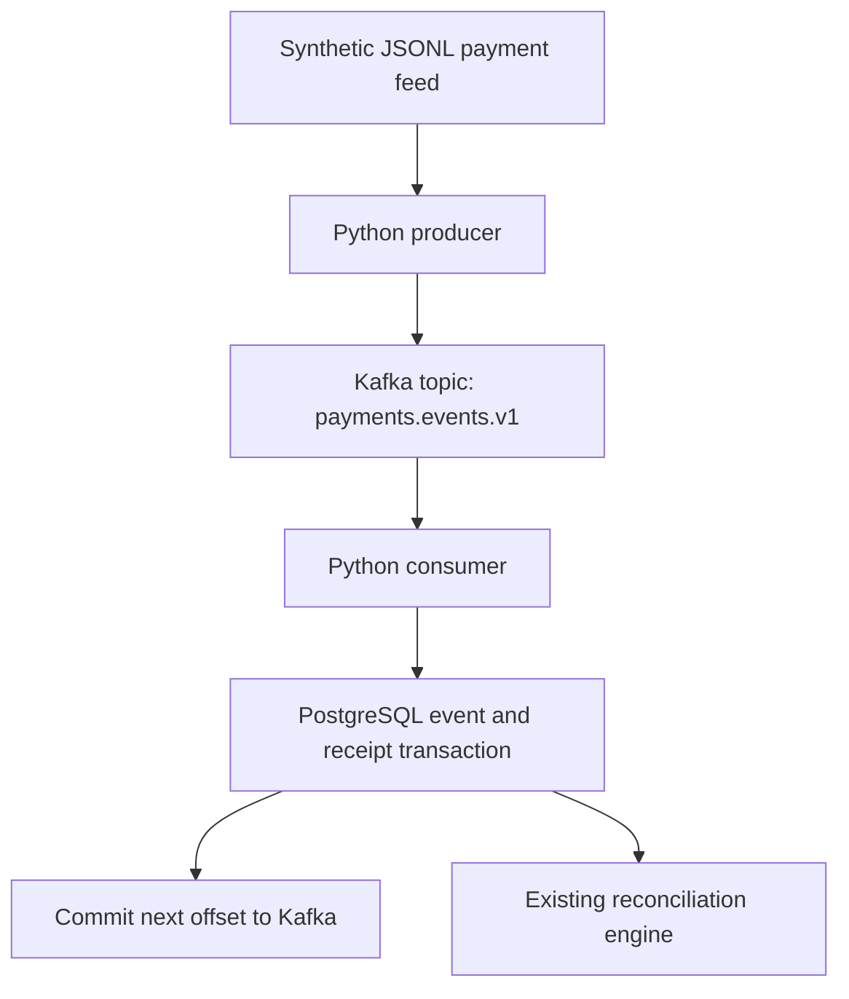

# Phase 2: Kafka event ingestion

Copy this update into your EXISTING `digital-payments-reconciliation` project root, merging the `scripts`, `src`, `database`, `tests`, and `kafka` folders. It contains no actual `.env`, generated data, or credentials. Your local database and its existing records remain in place.

Kafka runs in Docker. Python producer and consumer run on Windows using `py`. PostgreSQL remains on your Windows PC, so keep the working `.env` with `DB_HOST=127.0.0.1` and `DB_NAME=payments_recon_db`.

## Architecture



Only event ingestion is streamed in this phase. Settlement-file ingestion and reconciliation still use the existing CLI. The consumer does not automatically execute a reconciliation run on every message. Airflow scheduling and Power BI reporting are next steps.

## Start on Windows

Start Docker Desktop. In PowerShell, from the existing project ROOT (the folder containing requirements.txt):

```powershell
py -m pip install -r requirements-kafka.txt
docker compose -f kafka/docker-compose.yaml up -d
docker compose -f kafka/docker-compose.yaml ps
```

Wait for the `kafka` service to show healthy. The volume-initialization service completing with exit code 0 is normal.

Initialize the topic and additive database receipt table:

```powershell
py scripts/kafka_pipeline.py init
```

Publish the existing synthetic source, then consume it:

```powershell
py scripts/kafka_pipeline.py produce
py scripts/kafka_pipeline.py consume
```

The consumer exits after approximately 15 seconds without new messages. This is intentional for a small local demo. For a longer session:

```powershell
py scripts/kafka_pipeline.py consume --idle-seconds 300
```

`init` creates `recon.kafka_receipt` if needed and a three-partition topic with one replica. Broker retention is seven days for this topic. A single local broker offers no replication fault tolerance. Kafka is exposed on the Windows loopback interface only, at `127.0.0.1:29092`; this development setup uses plaintext without authentication.

## What to expect with your existing database

Your 102 unique events are already loaded from the JSONL batch. The producer sends all 103 source lines, including the deliberate replay. Therefore, the first Kafka consumer run should mostly/all log `DUPLICATE`; this is expected and proves the stream path preserves the existing event identities.

The first complete consumption creates one receipt per Kafka topic/partition/offset (103 receipts for a first publication) while `recon.payment_event` remains at 102 rows. Republishing appends new Kafka messages and can create additional receipts without duplicating the 102 business events.

If you run consume again with the same group and publish nothing new, it should process 0 messages and exit after the idle timeout. Consumer group defaults to `payments-postgres-v1`.

In pgAdmin:

```sql
SELECT COUNT(*) AS unique_events FROM recon.payment_event;
SELECT COUNT(*) AS consumed_positions FROM recon.kafka_receipt;
SELECT outcome, COUNT(*) FROM recon.kafka_receipt GROUP BY outcome;
```

The consumer also supports new valid events: they are inserted with a Kafka source_batch_id. It does not overwrite an existing event ID with different data, and the existing one-final-event-per-transaction constraint is retained. This is not a payment status-change event model.

## Why replay is safe

1. Decode and validate the event.
2. Open a database transaction and serialize against the existing batch loader/reconciler using a PostgreSQL advisory lock.
3. Check the source coordinate and canonical event-content hash.
4. Insert the business event if new, or verify it is an identical replay.
5. Store a source receipt in the SAME transaction.
6. Commit PostgreSQL.
7. Synchronously commit Kafka offset + 1 for that exact partition.

If the database fails, the offset is not acknowledged. If the process stops after the database commit but before the Kafka commit, the message may return on restart and is recognized as a replay. This is **at-least-once delivery with idempotent database writes**, not a distributed exactly-once transaction.

Malformed messages and identity conflicts stop the consumer without acknowledging the failing message. A dead-letter topic and controlled remediation workflow are not implemented yet. Do not bypass a bad message by resetting offsets without investigating it.

## Optional crash/restart demonstration

Use a fresh consumer group so there are messages to replay:

```powershell
py scripts/kafka_pipeline.py consume --group payments-crash-demo-v1 --crash-after-db
```

Exit code 9 is deliberate. The database call completed, but the message's Kafka offset was not acknowledged. Restart with the SAME group, omitting the crash option:

```powershell
py scripts/kafka_pipeline.py consume --group payments-crash-demo-v1
```

Look for `DB_REPLAY` messages and verify that unique business-event counts remain unchanged. Because this second group replays coordinates already processed by the first group, many receipts may already exist; receipt keys are shared across groups while Kafka offsets are group-specific.

## Reconcile after streaming

Your settlement records and previous demo results are preserved. After the late-settlement demo, use the later timestamp again:

```powershell
py scripts/run.py reconcile --as-of "2026-01-09T18:00:00Z"
```

Replaying the same existing events should keep 7 open exceptions and 91 matched payments. Reconciliation remains a deliberate separate action in this phase.

## Restart and troubleshooting

```powershell
docker compose -f kafka/docker-compose.yaml logs --tail 80 kafka
docker compose -f kafka/docker-compose.yaml stop
docker compose -f kafka/docker-compose.yaml up -d
```

A named volume preserves Kafka logs and consumer offsets. Do not remove the volume to troubleshoot routine errors. Deleting broker storage and reusing the same topic name can reuse old coordinates; conflicting contents are rejected by the receipt check.

If producer/consumer cannot connect, verify Docker Desktop is running and the Kafka service is healthy. `127.0.0.1:29092` is for Python on Windows. A future containerized producer would use `kafka:19092` on the Compose network instead.

If topic initialization fails after the database migration succeeded, rerun it after the broker is healthy. Both initialization operations are repeatable.

## Validation

Run all tests from the project root:

```powershell
py -m unittest discover -s tests -v
```

Six stream-handler tests add to the original ten business-rule tests. They check database-before-offset ordering, precise next-offset acknowledgement, database failure, simulated post-commit crash, replay, and invalid messages. The crash/replay contract test uses a fake persistence callback, not a live PostgreSQL or Kafka service. Compose structure, CLI syntax, and the installed kafka-python OffsetAndMetadata signature were checked during development. Docker/broker/database integration is not verified in the build environment and must be exercised locally.

## References

- Apache Kafka official Docker image: https://kafka.apache.org/41/getting-started/docker/
- Apache single-node examples: https://github.com/apache/kafka/tree/4.1.2/docker/examples
- kafka-python consumer offset semantics: https://kafka-python.readthedocs.io/en/2.2.15/apidoc/KafkaConsumer.html
