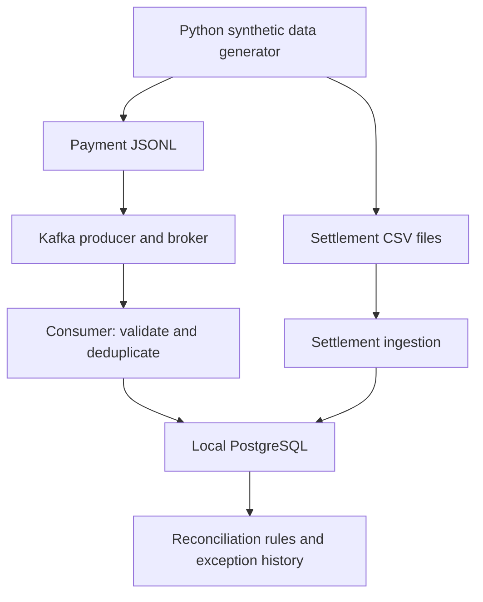

# Digital Payments Reconciliation Platform

A banking/fintech data engineering portfolio project that matches payment events against settlement records, detects financial discrepancies, and tracks exceptions from OPEN to RESOLVED.

**Implemented: Python + PostgreSQL batch reconciliation and a Kafka producer/consumer ingestion path. Airflow settlement orchestration is included as an update for the existing loan-risk stack; Power BI reporting remains a next step. See [Kafka setup](KAFKA_SETUP.md) for the streaming update and its validation limits.**

All account and transaction data is synthetic. This is a learning implementation with illustrative settlement and fee rules, not a production payment-processing or regulatory system.

## Why this project

A payment marked successful does not prove that its settlement is correct. This project answers:

- Did each successful payment settle by its expected deadline?
- Do gross amount, fees, net amount, and currency match?
- Did the same event get replayed, or did a payment genuinely receive multiple settlements?
- Is a refund tied to a successful payment, and does its total exceed the original amount?
- Does a missing-settlement exception resolve when the late settlement arrives?

## Architecture



The database runs on your Windows PC at `127.0.0.1:5432`, in a new database called `payments_recon_db`. It is separate from the loan portfolio database. Reuse an existing PostgreSQL role if appropriate; no password reset is needed.

## Implemented controls

- Integer money in minor units, avoiding binary floating-point calculations.
- Explicit timezone-aware event timestamps, normalized to UTC.
- Content-hash batch deduplication.
- Event-ID and settlement-ID replay detection using canonical payload hashes.
- Reused source IDs with different contents fail rather than silently overwrite financial records.
- A database transaction per input file: partial writes roll back on failure.
- Row validation failures reject the entire file and write rejection reasons to local quarantine files.
- One final event per transaction; lifecycle event versioning is outside this first version.
- Payment/settlement matching and refund integrity checks.
- Immutable reconciliation-run results, plus a current exception table.
- Exceptions resolve when their underlying discrepancy disappears.
- A transaction-level advisory lock serializes ingestion and reconciliation to keep the snapshot consistent.
- Older as-of runs are rejected once a newer one has been processed, so current exception state cannot accidentally travel backward in time.

## Demo scenarios

| Synthetic case | Intended result |
|---|---|
| Exact replay of one payment event | Duplicate detected; no second payment row |
| `PAY0001` missing settlement | OPEN missing-settlement exception after the deadline |
| `PAY0002` wrong amount | AMOUNT_MISMATCH |
| `PAY0003` settlement arrives in a separate later file | Missing exception resolves; outcome becomes MATCHED_LATE |
| `PAY0005` wrong settlement currency | CURRENCY_MISMATCH |
| `PAY0007` two different settlement IDs | DUPLICATE_SETTLEMENT |
| Settlement referencing an unknown payment | UNMATCHED_SETTLEMENT |
| Refund referencing an unknown payment | UNMATCHED_REFUND |
| Refund total exceeds `PAY0008` original amount | EXCESS_REFUND |

The engine also checks for settlement of a failed payment, refund currency mismatch, and a refund predating its payment.

## Business assumptions

- Supported currencies are PKR and USD, both represented using 100 minor units per major unit. A currency mismatch is flagged; no foreign-exchange conversion occurs.
- Only successful payments are expected to settle.
- Expected fee is an illustrative **1%**, rounded down to the integer minor unit.
- Expected settlement deadline is **17:00 UTC on the next calendar day**, including weekends. A payment is pending through the deadline and missing only after it.
- Multiple different settlement records for a payment are treated as duplicates in this demo. Partial/split settlement is not supported.
- Matching controls use a priority order: settlement count, currency, then amounts. Each payment gets one settlement outcome per run rather than an exhaustive list of every possible discrepancy.
- Refund checks are integrity controls. Refund settlement and reversal accounting are not implemented.
- `as_of` filters business timestamps over currently ingested source data. It is not a full historical ingestion-time database reconstruction. Results from completed runs remain stored.

## Repository layout

```text
digital-payments-reconciliation/
├── database/001_schema.sql
├── scripts/run.py
├── src/payments/
│   ├── demo.py
│   ├── domain.py
│   └── storage.py
├── tests/test_reconciliation.py
├── data/events/
├── data/settlements/
├── data/quarantine/
├── docs/verification.sql
├── START_HERE.md
├── requirements.txt
├── .env.example
└── .gitignore
```

## Local setup on Windows

Use a supported Python 3 version and an existing PostgreSQL installation. No Docker or Kafka is needed for this first phase.

### 1. Create a separate database

In pgAdmin, open Query Tool on your existing administrator connection and run this statement separately:

```sql
CREATE DATABASE payments_recon_db OWNER loan_risk_app;
```

This assumes the existing `loan_risk_app` role from your earlier project is present. You can instead use your own role name, provided it owns the database or can create the project schema. Do not run the statement again if the database already exists.

### 2. Prepare Python and credentials

From the new project root:

```powershell
py -m venv .venv
.\.venv\Scripts\python.exe -m pip install -r requirements.txt
Copy-Item .env.example .env
```

Edit `.env` with the existing role's working password. Keep database name `payments_recon_db` and host `127.0.0.1`. Never commit the actual `.env`.

### 3. Initialize the tables and generate inputs

```powershell
.\.venv\Scripts\python.exe scripts\run.py init
.\.venv\Scripts\python.exe scripts\run.py generate
```

The deterministic generator writes 103 event lines (including one exact replay), 95 initial settlement rows, and one separate late settlement. There are 100 payment transactions: 95 successful and 5 failed, plus two successful refund transactions.

### 4. Ingest and reconcile the initial day

```powershell
.\.venv\Scripts\python.exe scripts\run.py ingest-events data\events\payments.jsonl
.\.venv\Scripts\python.exe scripts\run.py ingest-settlements data\settlements\settlements_initial.csv
.\.venv\Scripts\python.exe scripts\run.py reconcile --as-of 2026-01-07T18:00:00Z
.\.venv\Scripts\python.exe scripts\run.py report
```

For an empty project database, expected initial outputs are:

- 102 unique event records from 103 event lines; one duplicate event.
- 95 settlement rows.
- 8 open exceptions.
- 90 matched payments.

Run the ingest-events command again. The already successful source content is reported as SKIPPED and no payment rows are duplicated.

### 5. Add the late settlement

```powershell
.\.venv\Scripts\python.exe scripts\run.py ingest-settlements data\settlements\settlements_late.csv
.\.venv\Scripts\python.exe scripts\run.py reconcile --as-of 2026-01-09T18:00:00Z
```

Expected changes:

- Open exceptions drop from 8 to 7.
- `PAY0003`'s missing-settlement exception becomes RESOLVED.
- There are now 91 matched payments, including 1 MATCHED_LATE outcome.
- Previously completed run results remain available for comparison.

The test dates are deliberate historical simulation times. For this demo, use them in order. After running the later date, do not run an earlier date against current exception state. To replay the same later snapshot, run the later reconcile command again; a new run-history row is expected, but duplicate current exception keys are not.

## PostgreSQL outputs

| Table/view | Purpose |
|---|---|
| `recon.payment_event` | Validated final payment/refund source events and original JSON payloads |
| `recon.settlement` | Validated settlement records |
| `recon.ingestion_batch` | Successful batch hashes, source files, row counts, and replay counts |
| `recon.reconciliation_run` | One evaluation run, its as-of date, and summary counts |
| `recon.reconciliation_result` | Immutable outcomes and explanations for each run |
| `recon.exception` | Stable exception keys and current OPEN/RESOLVED state |
| `recon.vw_open_exceptions` | Reporting view of current open exceptions |
| `recon.vw_run_summary` | Per-run summary metrics for later dashboarding |

Use `docs/verification.sql` in pgAdmin to inspect the demo.

An exception's `amount_minor` represents its affected transaction amount (or total refunds for the excess-refund control), not a confirmed loss. Do not label its sum as fraud loss or mix currencies in a total. The ingestion ledger records successful batches; validation/database failures surface as CLI errors rather than rows in a failed-batch audit table.

## Tests and verification

```powershell
.\.venv\Scripts\python.exe -m unittest discover -s tests -v
```

The original ten business-rule tests cover intended demo exceptions/counts, late settlements, deadline boundaries, duplicate payment-event behavior, deterministic source files, integer-money validation, timezone checks, source parsing, and unexpected settlements of failed payments.

The complete suite now includes 20 tests: ten business-rule tests, six streaming-handler tests, and four Airflow task-configuration tests. These tests do not require live PostgreSQL, Kafka, or Airflow services and passed during development. PostgreSQL and Docker are unavailable in the build environment; SQL execution, transaction rollback behavior, database replay handling, and exception-state persistence need to be verified on your local PostgreSQL instance using the documented demo. The implemented SQL and Python source are included for review.

## Kafka event ingestion

The Kafka update adds an official single-node Docker broker, Python producer/consumer, additive receipt-table migration, and manual offset acknowledgement after PostgreSQL commits. It uses at-least-once delivery with idempotent business-event writes. Six additional handler tests pass, bringing the suite to 16 tests. Live broker/database integration must still be verified locally. Follow [KAFKA_SETUP.md](KAFKA_SETUP.md).

## Next phases

1. Power BI reporting of reconciliation rates, breaks, affected amounts by currency, and exception aging.
2. Automated PostgreSQL/Kafka integration tests and CI.

No distributed exactly-once guarantee, restart benchmark, production throughput result, or bank deployment is claimed.


## Airflow settlement orchestration

Follow [AIRFLOW_PAYMENTS_SETUP.md](AIRFLOW_PAYMENTS_SETUP.md) to attach the payments DAG to the existing loan-risk Airflow stack. The three tasks check sources, ingest settlement files, and reconcile at current UTC every 30 minutes. Payment credentials are isolated from inherited loan DB settings. Twenty pure-Python tests pass; live Docker/PowerShell installation and DB execution remain local verification steps. Kafka consumption and Power BI Desktop refresh are separate from this DAG.


## Demonstration status

The local demonstration verified batch ingestion, discrepancy detection, late-settlement resolution, Kafka consumption of 103 source messages, consumer-group resume with no new messages, and the expected replay demonstration. The business-event count remains 102 because one input event is a deliberate duplicate.

The Airflow DAG and installer are included; the final successful payments DAG run has not yet been confirmed. This repository does not include a payments dashboard, bank-statement reconciliation, or real customer records. The Airflow integration reuses the separate loan-risk project's Airflow stack; it is not a standalone Airflow deployment.
